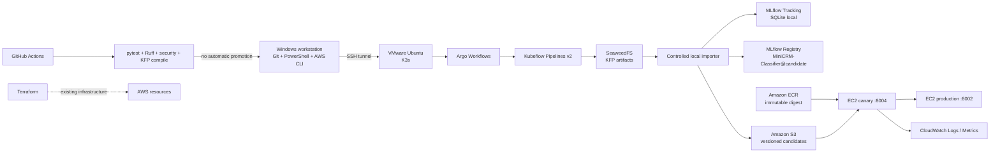

# Mini CRM Intelligence — architecture

The K3s cluster uses Kubeflow Pipelines and Argo Workflows. Argo CD is not part
of this platform and must not be reintroduced. The five KFP components remain
the source of truth for data preparation, training, evaluation, validation and
candidate manifest creation.

MLflow is intentionally kept outside the Pods. The operator retrieves the
completed KFP artifacts through local SSH tunnels and runs
`ml/kfp_mlflow.py` on Windows. This avoids sharing a Windows SQLite file with
Kubernetes workloads and avoids putting AWS credentials in Pods.

S3 publication and EC2 deployment are explicit PowerShell actions. A canary is
allowed on `127.0.0.1:8004`; production `127.0.0.1:8002` requires a separate
human approval and is never promoted by CI or by the training pipeline.
