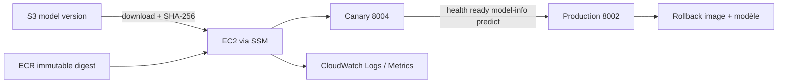

# Déploiement AWS contrôlé

Cette procédure ne lance pas Terraform et ne modifie pas le conteneur de production `127.0.0.1:8002`. Elle publie une image immuable dans le dépôt ECR existant puis exécute un canary temporaire sur `127.0.0.1:8004` via SSM.

## Pré-requis

- Profil AWS CLI `mini-crm` authentifié, région `eu-north-1`.
- Accès au compte `251538491265`.
- Docker Linux disponible (la VM Linux peut être utilisée si Docker Desktop n'est pas installé).
- Aucun credential permanent dans le dépôt.

```powershell
.\scripts\aws\check-environment.ps1
```

Le fichier `infra/aws/terraform.tfstate` est volontairement ignoré par Git. S'il est absent, récupérer le state officiel depuis CloudShell ou le backend autorisé avant toute opération Terraform. Ne jamais en inventer un.

## Validation et publication ECR

```powershell
git switch feat/aws-terraform
git pull --ff-only
pytest -q
python -m ruff check .
.\scripts\aws\build-push-ecr.ps1
```

Le tag par défaut est le SHA Git complet. Le script refuse de remplacer un tag existant et affiche le digest ECR.

## Canary SSM

Utiliser la version S3 et le SHA-256 vérifiés du modèle :

```powershell
.\scripts\aws\deploy-canary.ps1 `
  -Image "251538491265.dkr.ecr.eu-north-1.amazonaws.com/mini-crm-api:<commit-sha>" `
  -ModelPath "/opt/mini-crm/models/RNpfkR7F9N1cdIgR6w2YS2K4G07QnvDz.joblib" `
  -ModelVersion "RNpfkR7F9N1cdIgR6w2YS2K4G07QnvDz" `
  -ModelSha256 "2e78ebc2c60209baaa9b3065ae59e9d92bd06dfdcb2672d18344d0642735e083"
```

Conserver le `CommandId`, puis récupérer stdout/stderr avec `ssm get-command-invocation`. Une erreur arrête le canary ; la promotion vers `8002` n'est pas automatisée.

## Promotion et rollback

La promotion exige une référence ECR par digest (`repo@sha256:...`), une version S3 existante et un SHA-256 vérifié. Elle conserve l'inspection Docker et l'image précédente dans `/opt/mini-crm/deployments/<timestamp>/`.

```powershell
.\scripts\aws\promote-production.ps1 `
  -Image "251538491265.dkr.ecr.eu-north-1.amazonaws.com/mini-crm-api@sha256:<digest>" `
  -ModelPath "/opt/mini-crm/models/RNpfkR7F9N1cdIgR6w2YS2K4G07QnvDz.joblib" `
  -ModelVersion "RNpfkR7F9N1cdIgR6w2YS2K4G07QnvDz" `
  -ModelSha256 "2e78ebc2c60209baaa9b3065ae59e9d92bd06dfdcb2672d18344d0642735e083"
```

Le script refuse `8002` si l'image, la version S3 ou le modèle ne sont pas vérifiés. Le rollback se lance avec le digest précédent et n'est considéré réussi qu'après les quatre contrôles HTTP :

```powershell
.\scripts\aws\rollback-production.ps1 `
  -PreviousImage "251538491265.dkr.ecr.eu-north-1.amazonaws.com/mini-crm-api@sha256:<ancien-digest>" `
  -ModelPath "/opt/mini-crm/models/RNpfkR7F9N1cdIgR6w2YS2K4G07QnvDz.joblib"
```

Un rollback applicatif restaure l'image et le conteneur. Un rollback ML restaure également la version S3 et son empreinte ; les deux opérations sont indépendantes et doivent être tracées ensemble.

## CloudWatch

`infra/aws/cloudwatch.tf` prépare un Log Group `/mini-crm/api` avec une rétention de 7 jours, un filtre d'erreurs, une alarme CPU EC2 et le dashboard `MiniCRM-Observability`. `cloudwatch_iam.tf` limite le rôle EC2 à `CreateLogStream`, `DescribeLogStreams` et `PutLogEvents` sur ce groupe.

Le dashboard Terraform est organisé en quatre sections sur deux colonnes :

- **Infrastructure Health** : CPU, trafic réseau, contrôles de santé EC2 et opérations EBS.
- **Application Monitoring** : compteur `MiniCRM/API · ApplicationErrors` et limites de télémétrie HTTP.
- **Reliability & Alerting** : état de l'alarme CPU et historique du compteur d'erreurs.
- **Operations** : derniers événements du groupe `/mini-crm/api`, rétention, alarme et liens CloudWatch.

Les compteurs HTTP (requêtes, statuts et latence), mémoire et disque ne sont pas présentés comme disponibles : ils nécessitent des champs de logs structurés vérifiés ou une instrumentation/agent, qui ne sont pas activés par cette configuration. Les widgets EC2/EBS demandent uniquement des métriques natives. Leur présence et leurs points récents doivent être confirmés dans le compte ; un widget sans points n'est pas une preuve de collecte.

Le dashboard contient un seul widget Logs Insights, limité aux 25 événements les plus récents. Une requête Logs Insights facture selon les données analysées et la tarification régionale ; éviter l'actualisation automatique fréquente et réduire la fenêtre temporelle si le groupe grossit. Le groupe conserve les logs 7 jours. Cette modification ne crée ni métrique personnalisée, ni agent, ni alarme supplémentaire. Le coût exact ne peut pas être estimé sans la consommation réelle et le tarif applicable au compte.

Avant toute mise à jour du dashboard distant, re-authentifier le profil et enregistrer sa définition actuelle dans un dossier privé hors dépôt :

```powershell
aws login --profile mini-crm
aws sts get-caller-identity --profile mini-crm --region eu-north-1
$BackupDir = Join-Path $HOME "cloudwatch-private"
New-Item -ItemType Directory -Force -Path $BackupDir | Out-Null
aws cloudwatch get-dashboard --dashboard-name MiniCRM-Observability --profile mini-crm --region eu-north-1 |
  Set-Content -Encoding utf8 (Join-Path $BackupDir "MiniCRM-Observability.before.json")
```

Auditer les métriques EC2 avant d'interpréter les graphes (la période renvoyée par `list-metrics` n'est pas un historique de points) :

```powershell
aws cloudwatch list-metrics --namespace AWS/EC2 --dimensions Name=InstanceId,Value=i-049bfd217926eb2b2 --profile mini-crm --region eu-north-1
aws cloudwatch list-metrics --namespace MiniCRM/API --metric-name ApplicationErrors --profile mini-crm --region eu-north-1
aws cloudwatch describe-alarms --alarm-names MiniCRM-EC2-CPUHigh --profile mini-crm --region eu-north-1
aws logs describe-log-streams --log-group-name /mini-crm/api --order-by LastEventTime --descending --limit 5 --profile mini-crm --region eu-north-1
```

Dans la session d'audit du 16 novembre 2026, l'identité AWS n'a pas pu être vérifiée car la session `mini-crm` avait expiré. La définition distante, les métriques présentes, l'état de l'alarme, les flux d'événements et les permissions effectives restent donc à revalider après réauthentification. Aucune mise à jour AWS n'a été effectuée. Avant l'application approuvée, comparer le backup au JSON Terraform et vérifier un plan sans remplacement ni destruction.

Le scan Checkov local du 16 novembre 2026 a réussi 90 contrôles et échoué 10. Les contrôles signalent notamment : chiffrement KMS et rétention d'un an pour les logs (`CKV_AWS_158`, `CKV_AWS_338`), detailed monitoring et IP publique de l'EC2 (`CKV_AWS_126`, `CKV_AWS_88`), chiffrement KMS ECR (`CKV_AWS_136`) et exigences S3 de notifications, access logging, réplication, lifecycle et KMS (`CKV2_AWS_62`, `CKV_AWS_18`, `CKV_AWS_144`, `CKV2_AWS_61`, `CKV_AWS_145`). Ces résultats couvrent l'infrastructure existante et ne sont pas causés par la définition du dashboard. Aucun de ces changements n'est appliqué ici : certains entraînent des coûts ou modifient la sécurité/la rétention de ressources existantes et demandent une décision distincte. Le bucket reste configuré selon les protections déjà présentes dans Terraform.

Le driver Docker `awslogs` n'est activé par la promotion que si le Log Group existe déjà (`-UseCloudWatchLogs`). Tant que le state Terraform officiel n'est pas récupéré, aucun Log Group, rôle ou alarme n'est créé automatiquement.



CloudWatch Metrics sont des séries numériques (CPU), CloudWatch Logs sont des événements (sorties API), les Alarms évaluent des seuils et le Dashboard regroupe les vues. Une seule instance EC2 reste une disponibilité simple, pas de haute disponibilité.

## Démonstration courte

1. Afficher le digest ECR et la version S3.
2. Montrer le `CommandId` SSM du canary et les quatre réponses HTTP.
3. Montrer `/model-info` et le SHA-256 attendu.
4. Montrer le conteneur de production et son digest.
5. Ouvrir `MiniCRM-Observability` et le Log Group après application Terraform validée.
6. Expliquer le backup de déploiement et le rollback contrôlé.

## Terraform

```powershell
terraform -chdir=infra/aws init -backend=false -input=false
terraform -chdir=infra/aws validate
```

Pendant cette phase, `terraform apply` et `terraform destroy` sont interdits. Les ressources AWS existantes ne doivent pas être recréées ni supprimées.

Pour la définition CloudWatch : `terraform fmt -check` et `terraform validate` passent localement. `dashboard_body` est construit avec `jsonencode`, et les widgets utilisent une grille 24 colonnes avec deux widgets de largeur 12 par ligne. La génération du plan dashboard seul est actuellement bloquée par une session AWS expirée (`InvalidClientTokenId`) ; elle doit être relancée après authentification, avant toute mise à jour réelle. La définition distante n'a pas été sauvegardée ni modifiée pendant cet audit, car l'authentification n'était pas disponible.

## Release candidate et approbation

Le script `scripts/aws/release.ps1` orchestre le preflight d'une release sans promouvoir automatiquement la production. Il vérifie l'identité AWS, le digest ECR, la clé et la version S3, le manifeste ML et le SHA-256, puis télécharge le candidat sur EC2 et déploie uniquement le canary.

```powershell
.\scripts\aws\release.ps1 `
  -Image "251538491265.dkr.ecr.eu-north-1.amazonaws.com/mini-crm-api@sha256:<digest>" `
  -ModelKey "candidates/<git-sha>/model.joblib" `
  -ModelVersion "<VersionId>" `
  -ModelSha256 "<sha256>" `
  -ManifestPath ".\models\model-manifest.json" `
  -WhatIf
```

Après un `WhatIf` réussi, l'exécution sans `-WhatIf` valide le canary et CloudWatch, mais conserve `production_unchanged=true`. La promotion réelle exige explicitement `-Promote -ApproveProduction` et reste une décision humaine.

Le déploiement de production conserve un conteneur arrêté `mini-crm-api-rollback-<timestamp>` et sa configuration nécessaire dans le backup distant. En cas d'échec, le conteneur précédent est renommé et redémarré ; un rollback n'est considéré réussi qu'après les quatre contrôles HTTP et la vérification du driver de logs.

## Preuve KFP → MLflow → S3 → canary

La chaîne a été vérifiée avec le candidat suivant, sans promotion production :

```text
KFP Run ID: eb3e4326-0052-4912-99d8-25f165358a93
MLflow Run ID: 00d3027e181043c38f691e65dfaf4b26
Registry: MiniCRM-Classifier version 3, alias candidate
S3 key: candidates/6af74e6521b1b9a278dfea83504b9c4e3dc0cbac/model.joblib
S3 model VersionId: cDCVIV7AwE.FPmDXdcwuVFN8CkdmuRGv
S3 manifest VersionId: euQqQvqLxfymTxXHA8gv2VKjMTqW.f6h
Model SHA-256: 8652266ea0fef5690c633955e31fcc654efd2357abd538f9c6d4f511e27431d5
Canary SSM CommandId: 54b08f6f-820a-4ec9-809e-2afc3b18965c
```

Le rapport `release-canary-report.json` confirme `canary-validated`,
`production_unchanged=true` et 12 événements CloudWatch récents. Les quatre
endpoints du canary `8004` et la santé de production `8002` ont répondu ; le
conteneur production n'a pas été modifié.

## Persistance du logging CloudWatch

Les scripts deploy-canary, deploy-production et rollback-production
configurent maintenant awslogs par defaut avec des log streams distincts.

Chaque nouveau conteneur publie ses logs dans /mini-crm/api.
Les options peuvent etre inspectees avec -WhatIf.

Attention : les tests WhatIf ne valident pas un rollback reel.
Avant toute automatisation de production, tester la restauration
complete de l'image, des variables et des montages en environnement isole.
