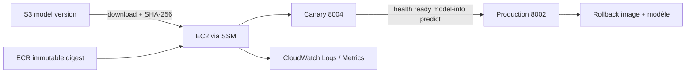

# Déploiement AWS contrôlé

Cette procédure ne lance pas Terraform et ne modifie pas le conteneur de production `127.0.0.1:8002`. Elle publie une image immuable dans le dépôt ECR existant puis exécute un canary temporaire sur `127.0.0.1:8004` via SSM.

## Pré-requis

- Profil AWS CLI `mini-crm` authentifié, région `eu-north-1`.
- Accès au compte `251538491265`.
- Docker Linux disponible (la VM Linux peut être utilisée si Docker Desktop n'est pas installé).
- Aucun credential permanent dans le dépôt.

```powershell
.\scripts\aws\check-environment.ps1
```

Le fichier `infra/aws/terraform.tfstate` est volontairement ignoré par Git. S'il est absent, récupérer le state officiel depuis CloudShell ou le backend autorisé avant toute opération Terraform. Ne jamais en inventer un.

## Validation et publication ECR

```powershell
git switch feat/aws-terraform
git pull --ff-only
pytest -q
python -m ruff check .
.\scripts\aws\build-push-ecr.ps1
```

Le tag par défaut est le SHA Git complet. Le script refuse de remplacer un tag existant et affiche le digest ECR.

## Canary SSM

Utiliser la version S3 et le SHA-256 vérifiés du modèle :

```powershell
.\scripts\aws\deploy-canary.ps1 `
  -Image "251538491265.dkr.ecr.eu-north-1.amazonaws.com/mini-crm-api:<commit-sha>" `
  -ModelPath "/opt/mini-crm/models/RNpfkR7F9N1cdIgR6w2YS2K4G07QnvDz.joblib" `
  -ModelVersion "RNpfkR7F9N1cdIgR6w2YS2K4G07QnvDz" `
  -ModelSha256 "2e78ebc2c60209baaa9b3065ae59e9d92bd06dfdcb2672d18344d0642735e083"
```

Conserver le `CommandId`, puis récupérer stdout/stderr avec `ssm get-command-invocation`. Une erreur arrête le canary ; la promotion vers `8002` n'est pas automatisée.

## Promotion et rollback

La promotion exige une référence ECR par digest (`repo@sha256:...`), une version S3 existante et un SHA-256 vérifié. Elle conserve l'inspection Docker et l'image précédente dans `/opt/mini-crm/deployments/<timestamp>/`.

```powershell
.\scripts\aws\promote-production.ps1 `
  -Image "251538491265.dkr.ecr.eu-north-1.amazonaws.com/mini-crm-api@sha256:<digest>" `
  -ModelPath "/opt/mini-crm/models/RNpfkR7F9N1cdIgR6w2YS2K4G07QnvDz.joblib" `
  -ModelVersion "RNpfkR7F9N1cdIgR6w2YS2K4G07QnvDz" `
  -ModelSha256 "2e78ebc2c60209baaa9b3065ae59e9d92bd06dfdcb2672d18344d0642735e083"
```

Le script refuse `8002` si l'image, la version S3 ou le modèle ne sont pas vérifiés. Le rollback se lance avec le digest précédent et n'est considéré réussi qu'après les quatre contrôles HTTP :

```powershell
.\scripts\aws\rollback-production.ps1 `
  -PreviousImage "251538491265.dkr.ecr.eu-north-1.amazonaws.com/mini-crm-api@sha256:<ancien-digest>" `
  -ModelPath "/opt/mini-crm/models/RNpfkR7F9N1cdIgR6w2YS2K4G07QnvDz.joblib"
```

Un rollback applicatif restaure l'image et le conteneur. Un rollback ML restaure également la version S3 et son empreinte ; les deux opérations sont indépendantes et doivent être tracées ensemble.

## CloudWatch

`infra/aws/cloudwatch.tf` prépare un Log Group `/mini-crm/api` avec une rétention de 7 jours, un filtre d'erreurs, une alarme CPU EC2 et le dashboard `MiniCRM-Observability`. `cloudwatch_iam.tf` limite le rôle EC2 à `CreateLogStream`, `DescribeLogStreams` et `PutLogEvents` sur ce groupe.

Le driver Docker `awslogs` n'est activé par la promotion que si le Log Group existe déjà (`-UseCloudWatchLogs`). Tant que le state Terraform officiel n'est pas récupéré, aucun Log Group, rôle ou alarme n'est créé automatiquement.



CloudWatch Metrics sont des séries numériques (CPU), CloudWatch Logs sont des événements (sorties API), les Alarms évaluent des seuils et le Dashboard regroupe les vues. Une seule instance EC2 reste une disponibilité simple, pas de haute disponibilité.

## Démonstration courte

1. Afficher le digest ECR et la version S3.
2. Montrer le `CommandId` SSM du canary et les quatre réponses HTTP.
3. Montrer `/model-info` et le SHA-256 attendu.
4. Montrer le conteneur de production et son digest.
5. Ouvrir `MiniCRM-Observability` et le Log Group après application Terraform validée.
6. Expliquer le backup de déploiement et le rollback contrôlé.

## Terraform

```powershell
terraform -chdir=infra/aws init -backend=false -input=false
terraform -chdir=infra/aws validate
```

Pendant cette phase, `terraform apply` et `terraform destroy` sont interdits. Les ressources AWS existantes ne doivent pas être recréées ni supprimées.

## Persistance du logging CloudWatch

Les scripts deploy-canary, deploy-production et rollback-production
configurent maintenant awslogs par defaut avec des log streams distincts.

Chaque nouveau conteneur publie ses logs dans /mini-crm/api.
Les options peuvent etre inspectees avec -WhatIf.

Attention : les tests WhatIf ne valident pas un rollback reel.
Avant toute automatisation de production, tester la restauration
complete de l'image, des variables et des montages en environnement isole.
