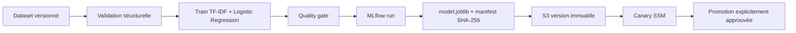

# Pipeline MLOps reproductible

Le pipeline local suit la chaîne suivante :



## Entraînement

```powershell
.\scripts\ml\run-training.ps1
```

Le script valide le dataset, entraîne le modèle, calcule les métriques, vérifie un F1 macro minimal de `0.60`, journalise un run MLflow local SQLite et produit `models/model-manifest.json`. Le manifeste contient le SHA Git, le hash du dataset, le hash du modèle, les métriques, la version du modèle et la quality gate.

Le modèle n'est jamais promu automatiquement par l'entraînement. L'artefact est transmis à la CI via `upload-artifact`, puis doit être publié vers S3 par une action explicitement approuvée :

```powershell
.\scripts\aws\publish-model.ps1 -ModelPath models/model.joblib -AllowNewVersion
.\scripts\aws\verify-model.ps1 -VersionId <VersionId> -ExpectedSha256 <sha256>
```

`-AllowNewVersion` est obligatoire pour éviter une publication accidentelle. Le bucket versionné conserve les anciennes versions.

## CI et CD

La CI exécute tests, entraînement, quality gate, contrôles de sécurité et build Docker. Le workflow `cd-preflight.yml` est manuel (`workflow_dispatch`) et ne possède aucun secret AWS : il valide seulement une référence ECR par digest, un VersionId S3 et un SHA-256. La promotion AWS reste exécutée depuis PowerShell/SSM avec authentification temporaire locale tant qu'un rôle GitHub OIDC n'est pas explicitement autorisé.

## Kubeflow Pipelines

`pipelines/kubeflow_pipeline.py` définit le contrat composable : `prepare_data → train → evaluate → validate → register`. Le SDK KFP 2.18.0 est isolé dans `requirements-kfp.txt`. Le pipeline a été compilé et exécuté sur le K3s VMware existant ; le run positif de référence est `eb3e4326-0052-4912-99d8-25f165358a93`.

## MLflow Model Registry

Le modèle candidat est enregistré dans le Registry MLflow local SQLite sous le
nom `MiniCRM-Classifier`. L'alias `candidate` désigne la version à tester. Le
bridge `ml/kfp_mlflow.py` récupère les artefacts SeaweedFS par tunnel local,
reconstruit les métriques et recharge le modèle par alias avant de déclarer
le succès.

Le script `ml/register_candidate.py` vérifie le manifeste, le SHA-256 et le
rechargement du modèle par son alias Registry. Cette opération ne publie pas
sur S3 et ne modifie pas la production EC2.

## Preuves et limites

- MLflow est local et SQLite ; aucun serveur public n'est déployé et aucun Pod
  KFP ne reçoit de credentials AWS.
- S3 et ECR sont versionnés, mais l'entraînement ne modifie pas la production.
- Une seule EC2 reste une architecture de démonstration, pas une plateforme hautement disponible.
- La publication S3 et le canary EC2 sont des étapes locales explicites ; la
  promotion production reste soumise à une approbation humaine.

## Release candidate — 2026-11-15

- Git SHA : `15667f74f7d4c739513be44467f69fb8482f09b8`
- S3 Key : `candidates/15667f74f7d4c739513be44467f69fb8482f09b8/model.joblib`
- S3 VersionId : `e7RV3.zAFX9J6IfEf7jRr2Gnd_Q6v.fH`
- Model SHA-256 : `93254d2e68b9131ac1ed6605c5242c5a960b045a9b30caee8447f9231c270d0d`
- F1 macro : `1.0`
- Quality gate : passed
- Status : candidate only, production unchanged

## Release KFP final — 2026-11-15

- KFP Run ID : `eb3e4326-0052-4912-99d8-25f165358a93`
- MLflow Run ID : `00d3027e181043c38f691e65dfaf4b26`
- Registry : `MiniCRM-Classifier` version `3`, alias `candidate`
- S3 Key : `candidates/6af74e6521b1b9a278dfea83504b9c4e3dc0cbac/model.joblib`
- S3 VersionId : `cDCVIV7AwE.FPmDXdcwuVFN8CkdmuRGv`
- Model SHA-256 : `8652266ea0fef5690c633955e31fcc654efd2357abd538f9c6d4f511e27431d5`
- S3 manifest VersionId : `euQqQvqLxfymTxXHA8gv2VKjMTqW.f6h`
- Canary SSM CommandId : `54b08f6f-820a-4ec9-809e-2afc3b18965c`
- Production : inchangée

## Orchestration de release

`scripts/aws/release.ps1` implémente la chaîne `S3 candidate → intégrité → canary → endpoints → CloudWatch → rapport`. Il accepte uniquement une image ECR par digest, une clé `candidates/<git-sha>/model.joblib`, un `VersionId` S3, un SHA-256 et un manifeste dont la quality gate est positive.

Le mode `-WhatIf` ne contacte pas SSM. Le mode canary prépare et vérifie le candidat sans modifier `8002`. La promotion nécessite deux indicateurs explicites (`-Promote -ApproveProduction`) ; un preflight ou un canary vert ne constitue jamais une autorisation de production.
