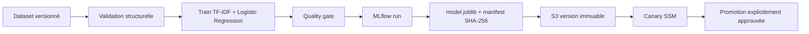

# Pipeline MLOps reproductible

Le pipeline local suit la chaîne suivante :



## Entraînement

```powershell
.\scripts\ml\run-training.ps1
```

Le script valide le dataset, entraîne le modèle, calcule les métriques, vérifie un F1 macro minimal de `0.60`, journalise un run MLflow local SQLite et produit `models/model-manifest.json`. Le manifeste contient le SHA Git, le hash du dataset, le hash du modèle, les métriques, la version du modèle et la quality gate.

Le modèle n'est jamais promu automatiquement par l'entraînement. L'artefact est transmis à la CI via `upload-artifact`, puis doit être publié vers S3 par une action explicitement approuvée :

```powershell
.\scripts\aws\publish-model.ps1 -ModelPath models/model.joblib -AllowNewVersion
.\scripts\aws\verify-model.ps1 -VersionId <VersionId> -ExpectedSha256 <sha256>
```

`-AllowNewVersion` est obligatoire pour éviter une publication accidentelle. Le bucket versionné conserve les anciennes versions.

## CI et CD

La CI exécute tests, entraînement, quality gate, contrôles de sécurité et build Docker. Le workflow `cd-preflight.yml` est manuel (`workflow_dispatch`) et ne possède aucun secret AWS : il valide seulement une référence ECR par digest, un VersionId S3 et un SHA-256. La promotion AWS reste exécutée depuis PowerShell/SSM avec authentification temporaire locale tant qu'un rôle GitHub OIDC n'est pas explicitement autorisé.

## Kubeflow Pipelines

`pipelines/kubeflow_pipeline.py` définit le contrat composable : `prepare_data → train → evaluate → validate → register`. Le SDK KFP n'est pas une dépendance par défaut ; la compilation nécessite un environnement local dédié avec `kfp`. Aucun pipeline Kubernetes complet n'a été déclaré exécuté.

## Preuves et limites

- MLflow est local et SQLite ; aucun serveur public n'est déployé.
- S3 et ECR sont versionnés, mais l'entraînement ne modifie pas la production.
- Une seule EC2 reste une architecture de démonstration, pas une plateforme hautement disponible.
- La prochaine étape est un CD OIDC contrôlé, puis l'orchestration KFP et un Model Registry formel sans créer de nouvelles ressources payantes.
